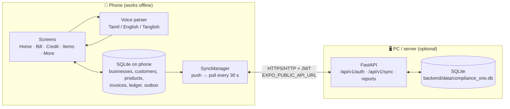
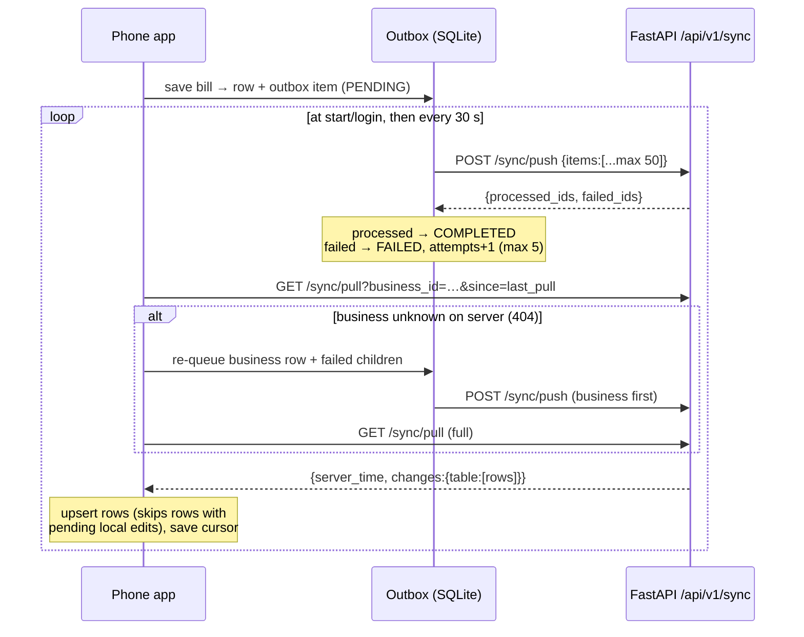
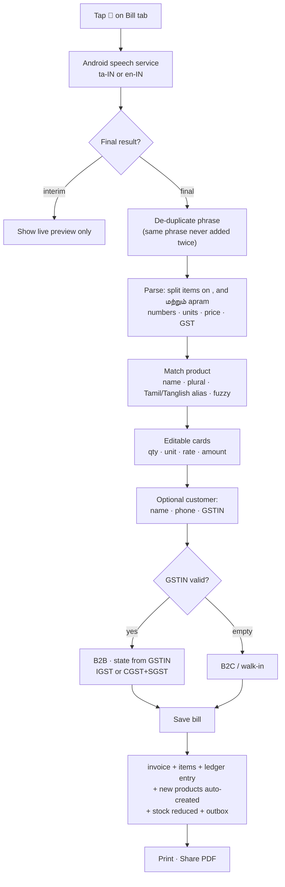

# Compliance One — Tamil/English GST billing for small shops

> **Offline-first, voice-powered GST billing** for small shop owners in Tamil Nadu.
> Speak or type a bill in Tamil, English or Tanglish ("rendu kilo arisi aruvathu rupai"), print or share it,
> track who owes you, and download a GST (GSTR‑1 style) JSON — **all without internet**.
> A small FastAPI server is used only for login, backup and multi-device sync.

This guide is written so that you can install, run, demo and fix the project **on your own, without any outside help**.
Every command is copy‑paste ready for **Windows PowerShell**.

| Guide | What is inside |
|---|---|
| 📘 **README.md** (this file) | What the app is, installation, running (cable / Wi‑Fi / standalone APK), daily commands, demo script |
| 📱 [docs/SCREENS.md](docs/SCREENS.md) | Every screen, page by page: purpose, how to use, Tamil label, data read/written, voice phrases, GST JSON |
| 🔌 [docs/API.md](docs/API.md) | Every backend route under `/api/v1`: method, auth, request/response examples, errors, sync contract |
| 🛠️ [docs/TROUBLESHOOTING.md](docs/TROUBLESHOOTING.md) | Symptom → cause → fix for build, install, connection, voice and data problems |
| 📐 [docs/DESIGN.md](docs/DESIGN.md) | The original design plan and tech-stack reasoning (kept for reference) |

---

## Table of contents

1. [What the app is](#1-what-the-app-is)
2. [Architecture](#2-architecture)
3. [Prerequisites (Windows)](#3-prerequisites-windows)
4. [Get the code](#4-get-the-code)
5. [Backend setup](#5-backend-setup)
6. [Mobile app — four ways to run it](#6-mobile-app--four-ways-to-run-it)
   - [A. Dev build over USB cable (Metro)](#a-dev-build-over-usb-cable-metro)
   - [B. Dev build over Wi‑Fi](#b-dev-build-over-wifi)
   - [C. Standalone release APK (no PC needed)](#c-standalone-release-apk-no-pc-needed)
   - [D. Share the APK with other phones](#d-share-the-apk-with-other-phones)
   - [E. Point the app at a hosted backend](#e-point-the-app-at-a-hosted-backend)
7. [Using the app (short tour)](#7-using-the-app-short-tour)
8. [Daily quick reference card](#8-daily-quick-reference-card)
9. [Demo script (5 minutes)](#9-demo-script-5-minutes)
10. [Project folder structure](#10-project-folder-structure)
11. [Running the tests](#11-running-the-tests)
12. [Git workflow](#12-git-workflow)
13. [Known limitations & roadmap](#13-known-limitations--roadmap)
14. [FAQ](#14-faq)

---

## 1. What the app is

**Compliance One** is a billing app for small shops (kirana, hardware, general stores) where the owner may not be comfortable with English or computers.

- 🗣️ **Voice billing** in Tamil, English or Tanglish — items appear as editable cards with quantity, unit, rate and amount.
- 🧾 **GST bills**: CGST+SGST for the same state, IGST for another state (decided from the customer's GSTIN), HSN codes, B2B bills when the customer has a GSTIN.
- 📴 **Offline-first**: everything is saved in a SQLite database on the phone. The app works with no internet and no server.
- 🔄 **Sync**: every change is written to an *outbox* on the phone; when the server is reachable, the outbox is pushed and server changes are pulled.
- 🧰 **One-tap hardware catalogue**: 61 common hardware items with Tamil/Tanglish names, HSN and GST.
- 📒 **Credit (khata) ledger**: who owes you, per-customer statement.
- 📊 **Reports**: today's sales, month summary, profit & loss, balance sheet, stock.
- 📤 **GST JSON download** (GSTR‑1 style summary: B2B, B2C, HSN summary), PDF sharing and Bluetooth thermal printing.
- 🌐 **Tamil by default**, English available in Settings.

## 2. Architecture

| Part | Technology | Where |
|---|---|---|
| Mobile app | Expo SDK 57, React Native 0.86, TypeScript, React Navigation, Zustand, i18next | `mobile/` |
| Phone database | SQLite via `expo-sqlite` (tables + views for balances, P&L, balance sheet) | on the phone |
| Voice | `expo-speech-recognition` (Android speech service, `ta-IN` / `en-IN`), rule-based parser + `fuse.js` matching | `mobile/src/voice/` |
| Sync | Outbox table + `SyncManager` (push then pull at start/login and every 30 s) | `mobile/src/sync/` |
| Backend | FastAPI, SQLAlchemy 2 (async) + aiosqlite, Alembic, JWT auth (python-jose + passlib/bcrypt) | `backend/` |
| Server database | SQLite file `backend/data/compliance_one.db` (override with `DATABASE_URL`) | on the PC/server |



<details>
<summary><b>How sync works (click to open)</b></summary>

Every save on the phone does two things in one transaction: it writes the row **and** adds an outbox entry (`INSERT`/`UPDATE`/`DELETE` + the row's data). The sync loop sends pending outbox entries to the server in batches of 50, in parent‑first order (business → customers → products → invoices → invoice items → payments → …). The server applies each item in its own savepoint and answers which ids succeeded and which failed. Then the phone pulls everything changed on the server since the last pull.



Full contract: [docs/API.md → Sync](docs/API.md#sync-push--pull).
</details>

<details>
<summary><b>How a voice bill becomes an invoice (click to open)</b></summary>


</details>

## 3. Prerequisites (Windows)

Use this checklist. Install in this order.

- [ ] **Git** — https://git-scm.com/download/win
- [ ] **Node.js 20 LTS or newer** (includes `npm`/`npx`) — https://nodejs.org
- [ ] **Python 3.14** (3.12+ also works) — https://www.python.org/downloads/ → tick **"Add python.exe to PATH"**
- [ ] **JDK 17** — Microsoft Build of OpenJDK 17 — https://learn.microsoft.com/java/openjdk/download — and set `JAVA_HOME`
- [ ] **Android SDK** in a path **without spaces**: `C:\Android\Sdk` (install via Android Studio → SDK Manager, or command-line tools)
- [ ] **adb** (comes with SDK *platform-tools*) on `PATH`
- [ ] **Phone**: Developer options + **USB debugging** on
- [ ] **Project in a short path**: `C:\co`
- [ ] Docker is **not** needed (a `docker-compose.yml` exists but is optional)

<details>
<summary><b>Why the Android SDK must be in a path with NO spaces</b></summary>

React Native 0.86 compiles native C++ code (Hermes, new architecture, expo-sqlite etc.) with the Android **NDK** using CMake/Ninja. When the SDK/NDK sits under a folder with a space — for example `C:\Users\Sathyan Raj\AppData\Local\Android\Sdk` — some of the generated linker command lines break at the space. The build then fails with long lists of **`undefined symbol: std::__ndk1::...`** or `ld.lld: error: unable to find library` (libc++ link errors). Moving the SDK to `C:\Android\Sdk` fixes it permanently.
</details>

<details>
<summary><b>Why the project should sit in a short path like <code>C:\co</code></b></summary>

Windows has a 260-character path limit for many tools. The Android build creates very deep folders (`node_modules\...\android\.cxx\RelWithDebInfo\<hash>\arm64-v8a\...`). In a long path such as `C:\Users\<name>\Documents\GitHub\Compilance_One-Application\mobile\...` CMake and Ninja hit the limit and fail with "file not found" or "filename too long" errors. `C:\co` keeps every path short.
</details>

### 3.1 Install JDK 17 and set JAVA_HOME

```powershell
winget install Microsoft.OpenJDK.17
# Find the folder it installed to (version number may differ):
Get-ChildItem "C:\Program Files\Microsoft" -Directory | Where-Object Name -like "jdk-17*"
# Set JAVA_HOME permanently for your user (adjust the folder name if different):
[Environment]::SetEnvironmentVariable("JAVA_HOME", "C:\Program Files\Microsoft\jdk-17.0.13.11-hotspot", "User")
```

Close and reopen PowerShell, then check:

```powershell
java -version
echo $env:JAVA_HOME
```

### 3.2 Android SDK at C:\Android\Sdk

1. Install **Android Studio** → *More Actions → SDK Manager*.
2. Set **Android SDK Location** to `C:\Android\Sdk` (create the folder first).
3. In *SDK Platforms* tick the latest Android platform; in *SDK Tools* tick **Android SDK Build-Tools**, **NDK (Side by side)**, **CMake**, **Android SDK Platform-Tools**. (Gradle will also download the exact NDK version it needs on first build.)
4. Set environment variables:

```powershell
[Environment]::SetEnvironmentVariable("ANDROID_HOME", "C:\Android\Sdk", "User")
[Environment]::SetEnvironmentVariable("ANDROID_SDK_ROOT", "C:\Android\Sdk", "User")
$p = [Environment]::GetEnvironmentVariable("Path", "User")
[Environment]::SetEnvironmentVariable("Path", "$p;C:\Android\Sdk\platform-tools", "User")
```

Reopen PowerShell and check `adb version`.

> If you previously had the SDK in `C:\Users\<you>\AppData\Local\Android\Sdk`, you can delete that old copy after moving (it is often 10–20 GB). See [Troubleshooting → low disk space](docs/TROUBLESHOOTING.md).

### 3.3 local.properties

After the `mobile\android` folder exists (it is created by the first `npx expo run:android`, and is not committed to git), make sure it contains a `local.properties` that points at the SDK. Note the doubled backslashes:

```powershell
Set-Content -Path C:\co\mobile\android\local.properties -Value "sdk.dir=C:\\Android\\Sdk"
Get-Content C:\co\mobile\android\local.properties
```

### 3.4 Phone: USB debugging

1. *Settings → About phone →* tap **Build number** 7 times → "You are now a developer".
2. *Settings → System → Developer options →* turn on **USB debugging** (and on Xiaomi/Redmi/POCO also **Install via USB**).
3. Plug in the cable, choose **File transfer**, accept the **"Allow USB debugging?"** prompt (tick *Always allow*).
4. Check on the PC:

```powershell
adb devices
# Expect:  <serial>    device      ("unauthorized" = accept the prompt on the phone)
```

## 4. Get the code

```powershell
cd C:\
git clone https://github.com/Compliance-One/Compilance_One-Application.git co
cd C:\co
git checkout feat/backend-sqlite
git pull
```

## 5. Backend setup

The backend is **optional for billing** (the phone works offline) but is **required for Register/Login and sync**.

> ⚠️ **Always use `python -m ...`** (e.g. `python -m uvicorn`, `python -m alembic`, `python -m pytest`).
> On many office/college PCs, **Windows Application Control (Smart App Control / WDAC)** blocks `.exe` launchers inside `.venv\Scripts\` (like `uvicorn.exe`), giving "An Application Control policy has blocked this file". `python -m` runs the same tool through the already-allowed `python.exe`.

### 5.1 One-time setup

```powershell
cd C:\co\backend
python -m venv .venv
.\.venv\Scripts\Activate.ps1
python -m pip install --upgrade pip
python -m pip install -r requirements.txt
python -m alembic upgrade head
```

<details>
<summary>"Activate.ps1 cannot be loaded because running scripts is disabled"?</summary>

```powershell
Set-ExecutionPolicy -Scope CurrentUser -ExecutionPolicy RemoteSigned
```
Or skip activation entirely and call the venv's Python directly: `.\.venv\Scripts\python.exe -m uvicorn ...`.
</details>

### 5.2 Run the server

```powershell
cd C:\co\backend
.\.venv\Scripts\Activate.ps1
python -m uvicorn app.main:app --host 0.0.0.0 --port 8000
```

- `--host 0.0.0.0` makes it reachable from the phone over Wi‑Fi (not only from the PC).
- Check it: open **http://localhost:8000/** → `{"app":"Compliance One API","status":"online",...}`
- **Swagger / interactive API docs: http://localhost:8000/docs** (try every endpoint in the browser; click *Authorize* and paste an access token).
- Add `--reload` while editing backend code.

### 5.3 Configuration (.env)

Settings are read from environment variables or a `backend\.env` file (`app/core/config.py`):

| Variable | Default | Meaning |
|---|---|---|
| `DATABASE_URL` | `sqlite+aiosqlite:///./data/compliance_one.db` | Server database. Relative to the folder you start the server from (`backend\`). |
| `SECRET_KEY` | *(empty)* | JWT signing key. **Required when `ENV` is not development.** In development an insecure built-in key is used. |
| `ENV` | `development` | `development` / `dev` / `test` allow the fallback key; anything else (e.g. `production`) demands `SECRET_KEY`. |
| `ACCESS_TOKEN_EXPIRE_MINUTES` | `30` | Access token lifetime. The app refreshes automatically. |
| `REFRESH_TOKEN_EXPIRE_DAYS` | `30` | Refresh token lifetime. |
| `JWT_ALGORITHM` | `HS256` | JWT algorithm. |
| `CORS_ORIGINS` | localhost:8081, :19006, :8080, 127.0.0.1:8000 | Comma-separated browser origins (only matters for web clients; the phone app is not affected by CORS). |

Example `backend\.env`:

```powershell
@"
ENV=development
SECRET_KEY=change-me-to-a-long-random-string
DATABASE_URL=sqlite+aiosqlite:///./data/compliance_one.db
"@ | Set-Content C:\co\backend\.env
```

### 5.4 Where is the data?

- Server: **`C:\co\backend\data\compliance_one.db`** (created by `alembic upgrade head`; git-ignored). Open it with *DB Browser for SQLite* if you want to look inside. Delete it and re-run `python -m alembic upgrade head` for a clean server (phones keep their own data and will re-send it).
- Phone: inside the app's private storage (SQLite via expo-sqlite). It survives app updates installed with `adb install -r`, and is erased by uninstalling or `adb shell pm clear com.complianceone.app`.

### 5.5 Backend tests

```powershell
cd C:\co\backend
.\.venv\Scripts\Activate.ps1
python -m pytest -q
```

## 6. Mobile app — four ways to run it

| Mode | Needs PC running? | JS reloads instantly? | Use it for |
|---|---|---|---|
| **A. Dev build + USB cable** | Yes (Metro) | ✅ | Development, safest demo with a PC |
| **B. Dev build + Wi‑Fi** | Yes (Metro) | ✅ | Same, without a cable (home Wi‑Fi/hotspot) |
| **C. Release APK** | ❌ No | ❌ (rebuild to change) | Real shop use, demo without a PC |
| **D. Share APK** | ❌ | ❌ | Installing on other phones |

First, install the JavaScript packages once (and after every `git pull` that changes `package.json`):

```powershell
cd C:\co\mobile
npm install
```

> 🔑 **`EXPO_PUBLIC_API_URL` must end with `/api/v1`**, e.g. `http://localhost:8000/api/v1`. Without `/api/v1`, Register/Login return **404**. If it is not set, the app uses `http://10.0.2.2:8000/api/v1`, which only works in the Android **emulator**, not on a real phone.

### A. Dev build over USB cable (Metro)

**First time only — build and install the dev client (10–30 minutes):**

```powershell
cd C:\co\mobile
adb devices
npx expo run:android
```

This creates `mobile\android`, compiles the native app, installs **Compliance One** on the phone and starts Metro. You only need to repeat it when native modules or `app.json` change.

**Every day — start backend, connect cable, start Metro:**

```powershell
# Window 1: backend
cd C:\co\backend
.\.venv\Scripts\Activate.ps1
python -m uvicorn app.main:app --host 0.0.0.0 --port 8000
```

```powershell
# Window 2: phone + Metro
cd C:\co\mobile
adb devices
adb reverse tcp:8000 tcp:8000
adb reverse tcp:8081 tcp:8081
$env:EXPO_PUBLIC_API_URL = "http://localhost:8000/api/v1"
npx expo start --dev-client --clear
```

Open **Compliance One** on the phone. It connects to Metro on `localhost:8081` (forwarded through the cable by `adb reverse`) and to the backend on `localhost:8000`.

- Press **`r`** in the Metro window to reload, or shake the phone → *Reload*.
- **After unplugging/replugging the cable, run the two `adb reverse` lines again.**
- To make the API URL permanent instead of setting it each time, create `mobile\.env`:
  ```powershell
  Set-Content C:\co\mobile\.env "EXPO_PUBLIC_API_URL=http://localhost:8000/api/v1"
  ```
  (Restart Metro with `--clear` after changing it.)

### B. Dev build over Wi‑Fi

PC and phone must be on the **same Wi‑Fi** (a phone hotspot that the PC joins works well).

```powershell
ipconfig    # note the IPv4 Address of the Wi-Fi adapter, e.g. 192.168.1.23
```

```powershell
cd C:\co\mobile
$env:EXPO_PUBLIC_API_URL = "http://192.168.1.23:8000/api/v1"
npx expo start --dev-client --clear --lan
```

In the dev client on the phone, choose the server shown by Metro (e.g. `http://192.168.1.23:8081`) or scan the QR code.

- Backend must run with `--host 0.0.0.0`.
- Allow Python and Node through **Windows Defender Firewall** (Private network) when prompted.
- **Office/college Wi‑Fi often blocks device-to-device traffic ("client isolation")** — then use the cable (mode A) or a phone hotspot.

### C. Standalone release APK (no PC needed)

The release APK contains the JavaScript bundle inside it, so it runs **with no PC, no Metro, no cable**. All data lives in SQLite on the phone; bills, customers and items work fully offline. Sync simply waits and catches up whenever the server URL becomes reachable.

```powershell
cd C:\co\mobile
# Optional: the server the APK should sync with (baked in at build time)
$env:EXPO_PUBLIC_API_URL = "http://localhost:8000/api/v1"
cd android
.\gradlew assembleRelease
```

Output: `C:\co\mobile\android\app\build\outputs\apk\release\app-release.apk`

Install it over USB (keeps data if the signature matches):

```powershell
adb install -r C:\co\mobile\android\app\build\outputs\apk\release\app-release.apk
adb shell monkey -p com.complianceone.app -c android.intent.category.LAUNCHER 1
```

<details>
<summary><b>Release vs dev build — how they replace each other</b></summary>

- Both use the same package name **`com.complianceone.app`**, so only one can be installed at a time; installing one replaces the other.
- The release build is signed with `mobile\android\app\debug.keystore` (Expo's default). If both builds were made **on the same PC**, `adb install -r` replaces one with the other and **keeps the data**.
- If you get `INSTALL_FAILED_UPDATE_INCOMPATIBLE`, the installed app was signed with a different key (e.g. built on another PC). You must uninstall first (**this deletes the phone's data** — sync first if you need it):
  ```powershell
  adb uninstall com.complianceone.app
  ```
- **Switch back to the dev build:** run `npx expo run:android` again (or `cd android; .\gradlew installDebug`), then start Metro as in mode A.
- With the release APK and the backend on your PC, sync works only while the phone can reach the PC (cable + `adb reverse tcp:8000 tcp:8000`, or a Wi‑Fi URL baked in at build time).
</details>

### D. Share the APK with other phones

1. Copy `app-release.apk` (rename it e.g. `ComplianceOne.apk`) via WhatsApp (as a *Document*), Google Drive, Bluetooth or a USB cable.
2. On the other phone, open the file → allow **"Install unknown apps"** for the app you opened it from (WhatsApp/Files/Drive).
3. If **Play Protect** warns "unsafe app" → *More details → Install anyway* (it is just not from the Play Store).
4. Each phone has its **own** offline data. They share data only through the backend (same login + sync).

### E. Point the app at a hosted backend

When the backend is deployed (Render, Railway, a VPS…) with HTTPS, build the APK with that URL — `EXPO_PUBLIC_*` values are **baked in at build time**:

```powershell
cd C:\co\mobile
$env:EXPO_PUBLIC_API_URL = "https://your-backend.example.com/api/v1"
cd android
.\gradlew clean
.\gradlew assembleRelease
```

On the server set `ENV=production`, a strong `SECRET_KEY`, and run `python -m alembic upgrade head` before starting `python -m uvicorn app.main:app --host 0.0.0.0 --port $PORT`. Then every phone with this APK syncs over the internet whenever it is online.

## 7. Using the app (short tour)

The bottom bar has five tabs (Tamil label in brackets):

| Tab | Tamil | What you do there |
|---|---|---|
| 🏠 Home | முகப்பு | Today's sales, money received, money owed; six big tiles; *Bill by voice* button |
| 🧾 Bill | பில் | Voice/typed billing with editable item cards, customer + GSTIN, Save bill |
| 📒 Credit | கடன் | Customers, who owes what, add customer, new bill for a customer |
| 📦 Items | பொருள் | Product list, add/edit, **Load hardware shop items**, HSN search |
| ☰ More | மேலும் | All bills, full GST bill form, GST JSON, month summary, reports, P&L, balance sheet, ledger, stock, settings, logout |

**Voice phrase examples** (all tested in the parser):

| You say | Becomes |
|---|---|
| `2 kilo arisi 60 rupees, 1 sugar 45` | 2 KG rice @ ₹60; 1 sugar @ ₹45 |
| `rendu kilo arisi aruvathu rupai` | 2 KG rice @ ₹60 |
| `அரை கிலோ சர்க்கரை 45 ரூபாய்` | 0.5 KG sugar @ ₹45 |
| `bill to Ravi, 10 screws 2 rupees and 1 hammer 280` | customer Ravi; 10 screws @ ₹2; 1 hammer @ ₹280 |
| `3 packet milk 25 apram 2 soap 40` | 3 PKT milk @ ₹25; 2 soap @ ₹40 |
| `5 pcs ball valve 150 gst 18 percent` | 5 PCS ball valve @ ₹150, GST 18% |
| `வாடிக்கையாளர் முருகன், 2 பூட்டு 250` | customer முருகன்; 2 locks @ ₹250 |

Every screen is described in detail in **[docs/SCREENS.md](docs/SCREENS.md)**.

## 8. Daily quick reference card

<details open>
<summary><b>🟢 Start everything (cable mode)</b></summary>

```powershell
# Window 1 — backend
cd C:\co\backend; .\.venv\Scripts\Activate.ps1; python -m uvicorn app.main:app --host 0.0.0.0 --port 8000
```
```powershell
# Window 2 — phone + Metro
cd C:\co\mobile; adb devices; adb reverse tcp:8000 tcp:8000; adb reverse tcp:8081 tcp:8081; $env:EXPO_PUBLIC_API_URL="http://localhost:8000/api/v1"; npx expo start --dev-client --clear
```
</details>

<details>
<summary><b>🔁 After re-plugging the cable</b></summary>

```powershell
adb reverse tcp:8000 tcp:8000; adb reverse tcp:8081 tcp:8081
```
</details>

<details>
<summary><b>⬇️ Get latest code</b></summary>

```powershell
cd C:\co; git checkout feat/backend-sqlite; git pull
cd C:\co\mobile; npm install
cd C:\co\backend; .\.venv\Scripts\Activate.ps1; python -m pip install -r requirements.txt; python -m alembic upgrade head
```
</details>

<details>
<summary><b>📦 Build + install release APK</b></summary>

```powershell
cd C:\co\mobile\android; .\gradlew assembleRelease
adb install -r app\build\outputs\apk\release\app-release.apk
adb shell monkey -p com.complianceone.app -c android.intent.category.LAUNCHER 1
```
</details>

<details>
<summary><b>🧹 Clean a broken native build</b></summary>

```powershell
cd C:\co\mobile\android; .\gradlew --stop
Remove-Item -Recurse -Force .\app\.cxx, .\app\build, .\build -ErrorAction SilentlyContinue
cd C:\co\mobile; npx expo run:android
```
</details>

<details>
<summary><b>🔍 Check what is running / free a port</b></summary>

```powershell
netstat -ano | findstr :8000
netstat -ano | findstr :8081
taskkill /PID <pid-from-last-column> /F
```
</details>

<details>
<summary><b>📜 See the app's logs from the phone</b></summary>

```powershell
adb logcat *:S ReactNative:V ReactNativeJS:V
```
</details>

## 9. Demo script (5 minutes)

Before the demo:

- [ ] Phone charged, internet ON (Google speech recognition is more reliable online), volume up
- [ ] Backend running (`http://localhost:8000/` shows "online") — only needed for login/sync
- [ ] Logged in; *Settings*: business name, GSTIN and state filled; language **தமிழ்**
- [ ] *Items* tab: tap **வன்பொருள் பொருட்கள் சேர் / Load hardware shop items** once

Script:

1. **Home (முகப்பு)** — "This is what the owner sees first: today's sales, money received, money owed. Big tiles, Tamil first."
2. **Items (பொருள்)** — show the hardware catalogue: HSN code and 18% GST on each item. Open *Add product → Find HSN*, type `arisi` or `pipe` to show offline HSN search.
3. **Bill (பில்)** — tap 🎤 (தமிழ் chip selected) and say: **"ரெண்டு பூட்டு, பத்து ஸ்க்ரூ"** or in Tanglish **"rendu poottu, pathu screw"**. Cards appear with rates from the catalogue. Edit a quantity to show it is editable.
4. Say an unknown item with a price, e.g. **"1 kilo arisi 60 rupees"** — it will be added to Items automatically on save.
5. **Customer + GSTIN** — type a name and GSTIN `33ABCDE1234F1Z5` (Tamil Nadu) → totals show **CGST + SGST**. Change it to `29ABCDE1234F1Z5` (Karnataka) → **IGST**. Tap **Save bill** → *Print* or *Share PDF*.
6. **More → GST JSON download** — download this month's JSON, show `b2b_invoices` containing the GSTIN bill.
7. **Credit (கடன்)** — the customer now owes the bill amount; open the ledger statement.
8. **Offline** — turn on airplane mode, make another bill: it still saves. Turn it off: sync catches up.

## 10. Project folder structure

```text
C:\co
├── README.md                    ← this guide
├── CHANGES.md                   ← change log
├── docker-compose.yml           ← optional, not needed on Windows
├── docs/                        ← API, SCREENS, TROUBLESHOOTING, DESIGN, ER diagram, architecture.mmd
├── backend/
│   ├── requirements.txt
│   ├── alembic.ini, alembic/versions/   ← single SQLite baseline migration (tables + report views)
│   ├── data/                    ← compliance_one.db lives here (git-ignored)
│   ├── app/
│   │   ├── main.py              ← FastAPI app, mounts /api/v1 and /api/v1/sync
│   │   ├── core/config.py       ← settings (.env), core/security.py (JWT, bcrypt)
│   │   ├── api/deps.py          ← get_current_user, business-ownership checks
│   │   ├── api/v1/              ← auth, sync, reports, gstr1, customers_ledger,
│   │   │                          business, products, invoices, payments, expenses, suppliers
│   │   ├── models/entities.py   ← SQLAlchemy tables
│   │   ├── services/            ← sync_reconciler, report_aggregator, gst_calculator, excel_export
│   │   └── db/                  ← session, views, types
│   └── tests/                   ← pytest (auth, sync reconciler, cash/bank)
└── mobile/
    ├── app.json, eas.json, package.json, index.ts (loads intl-pluralrules first)
    ├── android/                 ← generated by `npx expo run:android` (git-ignored)
    └── src/
        ├── screens/             ← Home, VoiceBilling, Customers, Products, More, InvoiceCreate,
        │                          InvoicesList, Inventory, Ledger, Reports, Dashboard (month summary),
        │                          ProfitLoss, BalanceSheet, GSTR1Export, Settings (+PrinterPanel), Auth
        ├── navigation/          ← RootNavigator (5 tabs + stack), route types
        ├── ui/                  ← big-button design system (Screen, Tile, BigButton, HsnPicker…)
        ├── db/                  ← schema/migrations, repositories (all reads/writes + outbox)
        ├── sync/                ← outbox, syncManager, netListener, lifecycle
        ├── voice/               ← parseTranscript, useSpeechToText, speechResults
        ├── gstr1/               ← simpleGstr1 (GST JSON) + official-format builder
        ├── data/                ← hsn.json (offline HSN list), hardwareCatalog.ts
        ├── lib/                 ← gst math, GSTIN, dates, number input, HSN search
        ├── pdf/, print/, billing/ ← invoice HTML/PDF, Bluetooth ESC/POS receipt
        ├── i18n/                ← en.json, ta.json (Tamil default)
        ├── auth/, api/          ← session/token store, HTTP client with auto-refresh
        └── __tests__/           ← Jest tests
```

## 11. Running the tests

```powershell
# Mobile: type check + unit tests (+ optional bundle check)
cd C:\co\mobile
npx tsc --noEmit
npx jest
npx expo export --platform android --output-dir $env:TEMP\co-export   # proves the JS bundle builds
```

```powershell
# Backend
cd C:\co\backend
.\.venv\Scripts\Activate.ps1
python -m pytest -q
```

Mobile tests cover the voice parser (Tamil/Tanglish numbers, units, aliases, plurals), speech de-duplication, GST JSON, HSN search, number input, invoice HTML, receipt formatting and Tamil/English key parity. Backend tests cover auth, the sync reconciler and cash/bank reports.

## 12. Git workflow

```powershell
cd C:\co
git status
git checkout feat/backend-sqlite      # the working branch (PR #11)
git pull                              # get teammates' changes
# ... make changes ...
git add -A
git commit -m "fix: short description"
git push origin feat/backend-sqlite
```

- Work happens on **`feat/backend-sqlite`**; changes reach `main` only through the pull request after review. Do not merge without review.
- Never commit `backend\data\*.db`, `.env` files, `node_modules`, or `mobile\android` (all git-ignored).
- If `git pull` reports conflicts, run `git status`, fix the marked files, then `git add -A` and `git commit`.

## 13. Known limitations & roadmap

**Known limitations (today):**

- Bills are saved as **UNPAID**; there is no "record payment" screen yet. The *Money In* tile opens the ledger (read-only). (The phone database already has `recordPayment` / `receiveFromCustomer` functions ready for a UI.)
- Voice recognition uses the phone's Google speech service; Tamil works best **online**. Offline needs the Tamil offline speech pack installed on the phone.
- GST rates in the offline HSN list and hardware catalogue are **typical rates after the September 2025 GST slab change** — always confirm with your auditor/CA.
- The GST JSON is a **summary in the project's own format**; the "official GSTN offline format" export is a **draft** — check it in the GST offline tool before filing.
- Backend routes for `business`, `products`, `invoices`, `payments`, `expenses`, `suppliers` are **in-memory demo endpoints** (data is lost when the server restarts, not linked to the phone's data). The phone uses only **auth**, **sync** (and the server-side reports read the synced data).
- `POST /api/v1/gstr1` uses a Postgres-only SQL function and fails on SQLite (the phone records GST exports through sync instead).
- Seeded Tamil/Tanglish voice aliases apply to the seeded hardware items (renaming an item loses its aliases).
- One business per phone/login.

**Roadmap:**

- [ ] Payment recording (cash/UPI received, partial payments) from Home → *Money In* and the ledger
- [ ] Step-by-step bill flow (choose customer → speak items → review → pay) for first-time users
- [ ] Hosted backend (Render/Railway) with HTTPS so phones sync over the internet
- [ ] Customer-specific prices, expenses screen, purchase bills
- [ ] Play Store build signed with a release keystore

## 14. FAQ

<details><summary><b>Do I need the backend running to make bills?</b></summary>
No. Billing, items, customers, reports and GST JSON all work offline. The backend is needed for Register/Login (first time) and for sync/backup.</details>

<details><summary><b>Do I need Docker?</b></summary>
No. Run the backend with Python as shown in section 5. `docker-compose.yml` is an optional alternative.</details>

<details><summary><b>Why does the phone say it can't reach the server?</b></summary>
Usually: backend not running, `adb reverse` not re-run after re-plugging, or `EXPO_PUBLIC_API_URL` missing <code>/api/v1</code>. See <a href="docs/TROUBLESHOOTING.md">Troubleshooting</a>.</details>

<details><summary><b>Will I lose data if I update the app?</b></summary>
Not with <code>adb install -r</code> or by installing a newer APK signed with the same key. You lose data if you uninstall, clear app data (<code>pm clear</code>), or install an APK signed with a different key (which forces an uninstall).</details>

<details><summary><b>How do I switch language?</b></summary>
More → Settings → Language → தமிழ் / English. Tamil is the default on first launch.</details>

<details><summary><b>How do I make a B2B (GST) bill?</b></summary>
On the Bill tab, fill the customer's name and 15-character GSTIN. The app checks the format, saves the GSTIN on the customer, uses IGST or CGST+SGST based on the GSTIN state code, and the bill appears under <code>b2b_invoices</code> in the GST JSON.</details>

<details><summary><b>Can two phones share the same shop data?</b></summary>
Yes, through the backend: log in with the same account on both phones and keep the server reachable; each phone pushes its changes and pulls the other's.</details>

<details><summary><b>Where do I change prices of the hardware items?</b></summary>
Items tab → Edit on any item. The seeded prices are only typical starting values.</details>

<details><summary><b>The app is installed but I can't find its icon.</b></summary>
Run <code>adb shell monkey -p com.complianceone.app -c android.intent.category.LAUNCHER 1</code>, and check the app drawer search for "Compliance One".</details>

---

Still stuck? Go to **[docs/TROUBLESHOOTING.md](docs/TROUBLESHOOTING.md)** — it lists every error we have seen, with the exact fix.
