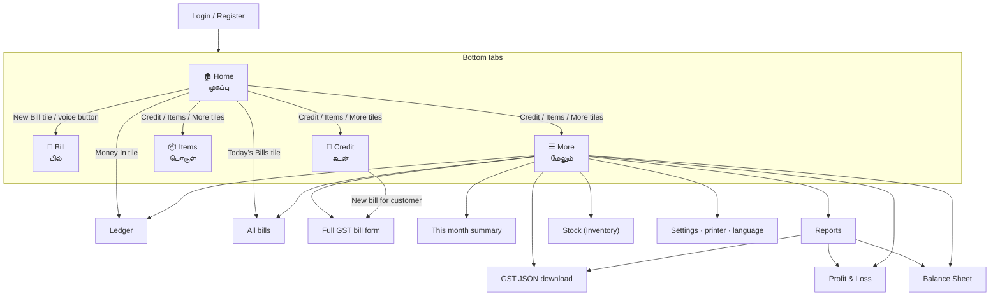

# Screens — page by page

[← Back to README](../README.md) · [API](API.md) · [Troubleshooting](TROUBLESHOOTING.md)

Every screen lives in `mobile/src/screens/<Name>/`. All data is read from and written to **SQLite on the phone** through `mobile/src/db/repositories.ts`; every write also adds an **outbox** row so it syncs later. Tamil is the default language (change it in *Settings*).

## Contents

- [Navigation map](#navigation-map)
- [Login / Register](#login--register)
- [Home (முகப்பு)](#home-முகப்பு)
- [Bill — voice billing (பில்)](#bill--voice-billing-பில்)
- [Credit — Customers (கடன்)](#credit--customers-கடன்)
- [Items — Products (பொருள்)](#items--products-பொருள்)
- [More (மேலும்)](#more-மேலும்)
- [All bills — Invoices list](#all-bills--invoices-list)
- [Full GST bill form — Invoice create](#full-gst-bill-form--invoice-create)
- [Reports, Month summary, Profit & Loss, Balance Sheet](#reports-month-summary-profit--loss-balance-sheet)
- [GST JSON / GSTR-1 export](#gst-json--gstr-1-export)
- [Inventory (stock)](#inventory-stock)
- [Ledger](#ledger)
- [Settings, printer, language](#settings-printer-language)
- [Data written by each screen (summary table)](#data-written-by-each-screen)

## Navigation map



---

## Login / Register

`screens/Auth/Login.tsx`, `screens/Auth/Register.tsx` · Tamil titles: **உள்நுழை** (Sign in), **கணக்கை உருவாக்கு** (Create account)

| | |
|---|---|
| **Purpose** | Create an owner account on the backend and sign in, so the phone's shop can be backed up and synced. |
| **How to use** | *Register*: name, 10-digit phone, optional email, password (min 8 characters) → *Create account*. *Login*: phone **or** email + password. |
| **Needs server?** | **Yes** — calls `POST /api/v1/auth/register` / `POST /api/v1/auth/login`. The API URL must end with `/api/v1`. |
| **Reads/writes** | Tokens are stored on the phone (secure token store). After sign-in, the phone's business row is linked to the user (`owner_user_id`) and queued for sync; if none exists, a business called "My Business" (state code 33, Tamil Nadu) is created. |
| **Errors** | 409 "Phone or email already registered"; 401 "Invalid credentials"; 404 → URL missing `/api/v1`; "Could not reach the server" → see Troubleshooting. |

## Home (முகப்பு)

`screens/Home/index.tsx`

| | |
|---|---|
| **Purpose** | The first screen: a greeting (வணக்கம் 🙏), a green strip with **today's sales** (இன்றைய விற்பனை), **received today** (இன்று வந்த பணம்) and **owed to you** (வர வேண்டியது), six big coloured tiles, and a big **Bill by voice** (குரலில் பில்) button. |
| **Reads** | `getDaySummary` — today's invoices, payments, and customer balances. Refreshes each time you return to Home. |
| **Writes** | Nothing. |

| Tile | Tamil | Opens |
|---|---|---|
| New Bill | புதிய பில் | Bill tab |
| Money In | பணம் வரவு | Ledger |
| Today's Bills | இன்றைய பில்கள் | All bills |
| Credit | கடன் | Credit tab |
| Items | பொருட்கள் | Items tab |
| More | மேலும் | More tab |

## Bill — voice billing (பில்)

`screens/VoiceBilling/index.tsx`, parser `voice/parseTranscript.ts`, speech `voice/useSpeechToText.ts`

**Purpose:** make a bill by speaking or typing. Items appear as editable cards; save in one tap.

**How to use**

1. Pick the speech language chip: **தமிழ்** (`ta-IN`) or **English** (`en-IN`).
2. Tap the big 🎤, speak one phrase, wait. The words show live in italics; when the phone finishes the phrase, the items are added **once**. Tap 🎤 again for the next phrase (listening stops after each phrase).
3. Or type a line in the box (e.g. `2 kilo arisi 60`) and tap **+**.
4. Check each card: name, **Qty**, **Unit**, **Rate**, amount; tap ✕ to delete a line. Lines matched to your Items show "HSN … • GST …% • from your items".
5. Optional **Customer** (👤): type a name — existing customers appear as chips to pick; phone; **GSTIN**.
6. The footer shows the **Total**; tap **✅ Save bill** → *Print* / *Share PDF* / OK.
7. *Continue to invoice* opens the full GST form with these items.

**Supported speech**

| Feature | Words understood |
|---|---|
| Numbers | digits (`2`, `60`, `2.5`); Tamil: ஒன்று/ஒரு, இரண்டு/ரெண்டு, மூன்று… பத்து, …; Tanglish: onnu/oru, rendu, moonu, naalu, anju, aaru, …, pathu, …, aruvathu (60), … |
| Fractions | அரை / arai = ½, kaal = ¼, mukkaal = ¾ |
| Units | kilo/kg, gram/g/gm/கிராம், litre/லிட்டர், ml, packet/pkt, pcs/ennam/எண்ணம், box, … |
| Price | a number after the item, or after `rupees`, `rs`, `rupai`, `ரூபாய்`, `ரூபாய்க்கு`, `at`, `each`, `rate`, `விலை` |
| GST | `gst 18 percent`, `18 சதவீதம்` |
| Several items | separate with `,` `;` `.`, or say `and`, `மற்றும்`, `plus`, `apram`, `அப்புறம்` |
| Customer | `bill to Ravi, …`, `customer Ravi …`, `வாடிக்கையாளர் முருகன், …` |
| Item names | English, Tamil script or Tanglish; plurals (`screws`); small spelling slips (`hamer`, `cemnt`); Tamil/Tanglish names of seeded hardware items (`aani`, `poottu`, `suthiyal`, `kuzhai`, `simentu`, `பூட்டு`, `ஆணி` …) and common kirana words (`arisi`, `sakkarai`, `paal`, `ennai`, `paruppu` …) |

**Examples**

| Say | Result |
|---|---|
| `2 kilo arisi 60 rupees, 1 sugar 45` | 2 KG arisi @ 60 · 1 sugar @ 45 |
| `rendu kilo arisi aruvathu rupai` | 2 KG arisi @ 60 |
| `அரை கிலோ சர்க்கரை 45 ரூபாய்` | 0.5 KG சர்க்கரை @ 45 |
| `ரெண்டு பூட்டு, பத்து ஸ்க்ரூ` (after loading hardware items) | 2 × Padlock 50mm @ 250 · 10 BOX Wood Screw @ 90, both 18% |
| `bill to Ravi, 10 screws 2 rupees and 1 hammer 280` | customer Ravi · 10 screws @ 2 · 1 hammer @ 280 |
| `5 pcs ball valve 150 gst 18 percent` | 5 PCS ball valve @ 150, 18% |

**Customer, GSTIN and tax**

- GSTIN is checked as you type (15 characters, e.g. `33ABCDE1234F1Z5`). An invalid GSTIN shows a red message and blocks saving; a GSTIN needs a customer name.
- With a valid GSTIN the bill is **B2B**: the first two digits give the buyer's state. Same state as your business → **CGST + SGST**; another state → **IGST**. The tax rows under the items show which.
- Without a customer name the bill is a **walk-in** sale (no ledger entry).

**Reads:** products (with Tamil/Tanglish aliases for seeded items), customers.
**Writes (on Save):** `invoices` (status UNPAID, input mode `voice`), `invoice_items`, a `ledger_entries` debit if there is a customer, a new/updated `customers` row (GSTIN → B2B), a new `products` row for every line that did not match an item (name, rate, unit, HSN/GST), stock reduced for matched items, and outbox rows for all of these.

## Credit — Customers (கடன்)

`screens/Customers/index.tsx` · Tamil title **வாடிக்கையாளர்கள்**

| | |
|---|---|
| **Purpose** | Your customer list with GSTIN status and outstanding balance (what they owe). |
| **How to use** | Search by name, GSTIN or phone. **+ Add customer**: legal name (required), trade name, GSTIN (optional, validated; the state is taken from it), PAN, phone (optional), email, address, credit limit. **Edit** a customer. **New bill** opens the full GST bill form for that customer. |
| **Reads** | `listCustomers` (with balances from the `v_customer_balances` view). |
| **Writes** | `upsertCustomer` → `customers` + outbox. A customer with a GSTIN is saved as type **B2B**, otherwise **B2C**. |

## Items — Products (பொருள்)

`screens/Products/index.tsx`, `ui/HsnPicker.tsx`, `data/hardwareCatalog.ts`, `data/hsn.json` · Tamil title **பொருட்கள்**

| | |
|---|---|
| **Purpose** | Your item master: name, SKU, HSN, category, unit, selling/purchase price, GST rate, stock, minimum stock. |
| **How to use** | Search by name/SKU/HSN; filter by category chips (All, Plumbing, Electricals, Hardware, Paints, Building materials, Tools). **Add/Edit** an item. **Delete** removes it from this phone. |
| **Load hardware shop items** | Button **வன்பொருள் பொருட்கள் சேர் / Load hardware shop items** (big on an empty list, at the bottom of a full list). Adds **61** common hardware items — PVC pipes/elbows/tees (HSN 3917), ball valves & taps (8481), screws/bolts/washers (7318), nails (7317), hinges/tower bolts/handles (8302), locks (8301), paints (3208/3209), putty (3214), cement (2523), wires (8544), switches/MCB (8536), bulbs (8539), tapes (3919), Fevicol/M-Seal (3506), sandpaper (6805), tools (8202–8207), measuring tape (9017)… — each with a typical price, unit, **18% GST**, stock 50. Tapping again adds nothing (it skips names that already exist). Items are queued for sync. |
| **HSN search** | In the add/edit form tap **Find HSN (HSN தேடு)**, type an item name in English, Tanglish or Tamil (`rice`, `arisi`, `அரிசி`, `pipe`) or a code prefix (`1006`). Picking a result fills the HSN code **and** GST rate. The list (≈450 common codes) is offline. *GST rates shown are typical post‑Sept‑2025 rates — confirm with your auditor.* |
| **Reads** | `listProducts`. |
| **Writes** | `upsertProduct` / `deleteProduct` / `seedHardwareCatalog` → `products` + outbox. |

## More (மேலும்)

`screens/More/index.tsx`

| Row | Tamil | Opens |
|---|---|---|
| All bills | எல்லா பில்களும் | Invoices list |
| Full GST bill form | முழு GST பில் படிவம் | Invoice create |
| GST JSON download | GST JSON பதிவிறக்கம் | GSTR‑1 export |
| This month summary | இந்த மாத சுருக்கம் | Month summary (Dashboard) |
| Reports | அறிக்கைகள் | Reports |
| Profit & loss | லாபம் & நஷ்டம் | Profit & Loss |
| Balance sheet | இருப்புநிலை | Balance sheet |
| Customer ledger / money in | வாடிக்கையாளர் கணக்கு / பணம் வரவு | Ledger |
| Stock | இருப்பு | Inventory |
| Settings, printer, language | அமைப்புகள், பிரிண்டர், மொழி | Settings |
| Log out | வெளியேறு | asks to confirm, then signs out (phone data stays) |

## All bills — Invoices list

`screens/InvoicesList/index.tsx` · Tamil title **விலைப்பட்டியல்கள்**

| | |
|---|---|
| **Purpose** | Every bill with total sales and outstanding count. |
| **How to use** | Search by customer or number; filter **All / Unpaid / Partial / Paid / Overdue / Cancelled**; on a bill: **Share PDF** or **Print**. |
| **Reads** | `listInvoices`, `getInvoiceDetail` (for PDF/print). |
| **Writes** | Nothing (PDF is created in a temporary file and shared). |

## Full GST bill form — Invoice create

`screens/InvoiceCreate/index.tsx` · Tamil title **புதிய வரி விலைப்பட்டியல்**

| | |
|---|---|
| **Purpose** | A complete tax-invoice form (Rule 46 fields) for when you want full control. |
| **How to use** | Optional customer (name, GSTIN, state, address; or start from a customer in *Credit*); invoice date; add line items in a pop-up (name, HSN with **Find HSN**, qty, unit, price, discount %, GST %); the header shows **INTRA-STATE (CGST + SGST)** or **INTER-STATE (IGST)**; **Create invoice** → Print / Share PDF. The form resets after saving; double taps are ignored. |
| **Writes** | Same as voice save (`createInvoice`, input mode `text`). |

## Reports, Month summary, Profit & Loss, Balance Sheet

| Screen | File | Tamil | Shows | Reads |
|---|---|---|---|---|
| Reports | `screens/Reports` | அறிக்கைகள் | Pick a period: total sales, bills, sales before GST, GST collected (CGST/SGST/IGST); links to P&L, Balance Sheet, GST JSON | local invoices |
| This month summary | `screens/Dashboard` | இந்த மாதம் | Profit/loss this month, sales before GST, expenses, bills count, GST collected, customers owe you, stock value | local views |
| Profit & Loss | `screens/ProfitLoss` | இலாப நஷ்ட கணக்கு | Income, expenses, net profit/loss, by category. GST collected is **not** income. | local P&L view |
| Balance Sheet | `screens/BalanceSheet` | இருப்பு நிலைக் குறிப்பு | What you have (cash, bank incl. UPI, stock value, customers owe you) and what you owe (suppliers), net position | local balance-sheet view |

All are read-only and refresh when you come back to them.

## GST JSON / GSTR-1 export

`screens/GSTR1Export/index.tsx`, `gstr1/simpleGstr1.ts` · Tamil title **ஜிஎஸ்டிஆர்-1 ஏற்றுமதி**

| | |
|---|---|
| **Purpose** | Download a JSON summary of the month's sales for your accountant / GST filing. |
| **How to use** | Defaults to **this month** (change From/To). Tap **⬇ Download GST JSON** → the file is saved and the share sheet opens (WhatsApp, Drive, email…). A secondary button makes the **official GSTN offline format (draft)** — check it in the GST offline tool before filing. Warnings appear if your business GSTIN is missing or there are no bills. |
| **Rules** | **B2B** = the bill's customer has a GSTIN; otherwise **B2C**. HSN summary groups lines by HSN code + GST rate (missing HSN → `"NA"`). Amounts are numbers rounded to 4 decimals. Cancelled bills are excluded. |
| **Writes** | A `gstr1_exports` record (+ outbox) and the JSON file in the app's documents folder. |

Example file:

```json
{
  "gstin": "33AAAAA0000A1Z5",
  "period_from": "2026-11-01",
  "period_to": "2026-11-30",
  "total_invoices": 2,
  "total_b2b": 1,
  "total_b2c": 1,
  "b2b_invoices": [
    {
      "id": "6f1c…",
      "invoice_number": "INV-0002",
      "invoice_date": "2026-11-18",
      "invoice_type": "B2B",
      "customer_gstin": "29ABCDE1234F1Z5",
      "taxable_amount": 500,
      "cgst_amount": 0,
      "sgst_amount": 0,
      "igst_amount": 90,
      "total_amount": 590
    }
  ],
  "b2c_invoices": [
    {
      "id": "a2b9…",
      "invoice_number": "INV-0001",
      "invoice_date": "2026-11-18",
      "invoice_type": "B2C",
      "customer_gstin": null,
      "taxable_amount": 120,
      "cgst_amount": 0,
      "sgst_amount": 0,
      "igst_amount": 0,
      "total_amount": 120
    }
  ],
  "hsn_summary": [
    { "hsn_code": "8301", "gst_rate": 18, "total_quantity": 2, "total_taxable_value": 500, "total_tax": 90 },
    { "hsn_code": "NA", "gst_rate": 0, "total_quantity": 2, "total_taxable_value": 120, "total_tax": 0 }
  ],
  "generated_at": "2026-11-18T10:30:00.000Z"
}
```

## Inventory (stock)

`screens/Inventory/index.tsx` · Tamil title **சரக்கு**

| | |
|---|---|
| **Purpose** | Live stock and reorder monitoring: stock valuation, low-stock and out-of-stock counts, current stock, reorder level, asset value and cost per item. |
| **How to use** | Search an item → **Adjust** → choose the type — **Stock in**, **Stock out**, **Damage** or **Audit correction** (set the counted quantity) — enter the quantity and a reason/reference (e.g. a GRN number) → save. Removing more than you have is blocked ("Insufficient stock"). |
| **Writes** | `adjustProductStock` → `products.stock_quantity` + outbox. Sales reduce stock automatically. |

## Ledger

`screens/Ledger/index.tsx` · Tamil title **பேரேடு**

| | |
|---|---|
| **Purpose** | Khata view: total "customers owe you", and each customer's balance (Owes you / You owe / Settled). Tap a customer for a statement with ruled columns **Billed | Paid | Balance**. |
| **Reads** | `v_customer_balances`, ledger entries. |
| **Writes** | Nothing yet (payment recording is on the roadmap). |

## Settings, printer, language

`screens/Settings/index.tsx`, `screens/Settings/PrinterPanel.tsx` · Tamil title **அமைப்புகள்**

| Section | What it does |
|---|---|
| Language (மொழி) | தமிழ் / English — saved on the phone. |
| Your business (உங்கள் வணிகம்) | Business name, GSTIN (validated; leave blank if not registered), state, opening cash and bank balance → **Save business** (`updateBusinessProfile` → `businesses` + outbox). The state decides CGST+SGST vs IGST. |
| Receipt printer (ரசீது அச்சுப்பொறி) | Pair the Bluetooth ESC/POS printer (58/80 mm) in Android settings first → **Scan for printers** → pick it → **Print test receipt**; **Forget this printer** to clear. |
| Account | Signed-in user; sign out. |

## Data written by each screen

| Screen | businesses | customers | products | invoices + items | ledger_entries | gstr1_exports |
|---|:-:|:-:|:-:|:-:|:-:|:-:|
| Login/Register | ✅ link owner | | | | | |
| Bill (voice) | | ✅ | ✅ auto-create, stock − | ✅ | ✅ | |
| Full GST bill form | | ✅ | ✅ auto-create, stock − | ✅ | ✅ | |
| Credit (Customers) | | ✅ | | | | |
| Items | | | ✅ | | | |
| Inventory | | | ✅ stock | | | |
| GST JSON | | | | | | ✅ |
| Settings | ✅ | | | | | |

Every ✅ also writes an **outbox** row, which the sync loop sends to `POST /api/v1/sync/push`.
